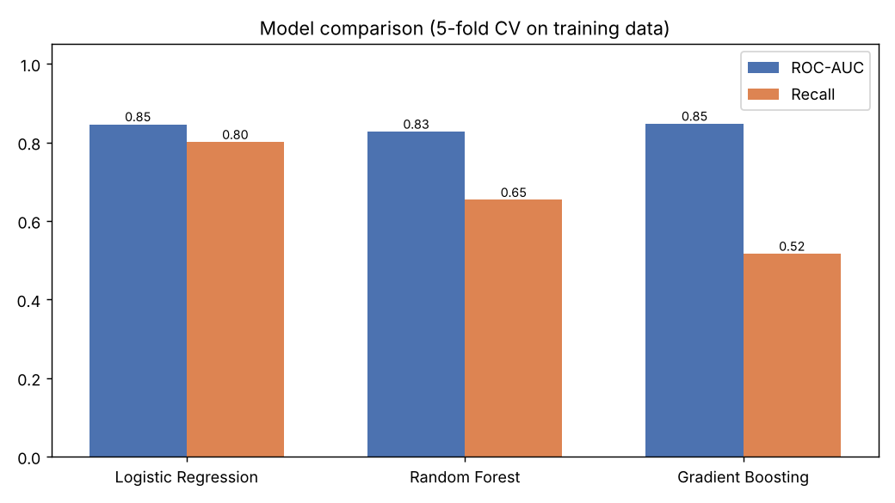

# Customer Churn Prediction

Predicts which telecom customers are likely to cancel, compares three classifiers, and turns the predictions into a retention list with an estimated business impact. Built on the IBM Telco Customer Churn dataset (7,043 customers).

## Summary

| | |
|---|---|
| Dataset | IBM Telco Customer Churn, 7,043 customers, 20 features |
| Churn rate | 26.5% (1,869 churned) |
| Selected model | Logistic Regression, chosen by 5-fold cross-validation on training data |
| Test result (scored once) | ROC-AUC 0.84, accuracy 74%, recall 79% |
| Retention list (top 20% by risk) | Captures 49.7% of churners at 66% precision (base rate 26.5%) |
| Top churn drivers | `TotalCharges`, `tenure`, `MonthlyCharges` |
| Strongest signal | Month-to-month contracts churn at 42.7%, versus 11.3% (one year) and 2.8% (two year) |

## Churn overview

<p align="center">
  
  
</p>

Customers on month-to-month contracts leave at roughly four times the rate of one-year contracts and fifteen times the rate of two-year contracts.

## Model selection

Models were compared with 5-fold cross-validation on the 80% training split. The 20% test set was not used for any choice, and it was scored once, for the selected model.

<p align="center">
  
</p>

| Model | CV ROC-AUC (±std) | CV recall |
|---|---|---|
| **Logistic Regression** (selected) | 0.846 (±0.012) | 0.801 |
| Random Forest | 0.827 (±0.012) | 0.654 |
| Gradient Boosting | 0.847 (±0.012) | 0.516 |

Gradient Boosting has a marginally higher ROC-AUC (0.847 vs 0.846), which is within the 0.005 tie tolerance. Recall then decides, and Logistic Regression catches far more churners. That matters because a missed churner costs more than a false alarm.

## Test set results

<p align="center">
  
  
</p>

On the 1,409-customer test set, the selected model scores ROC-AUC 0.84, accuracy 74.0%, and recall 78.6%. Drivers come from a Random Forest fitted on the same training data.

## Business impact

The retention list is the top 20% of customers ranked by predicted churn risk. On the test set, that list has 282 customers, of whom 186 churn. It captures 49.7% of all churners, and its precision is 66%, against a 26.5% base rate.

Scaled to the full 7,043-customer base, the list would hold about 1,409 customers and about 930 likely churners, assuming the test-set rates hold. Estimated value, with these assumptions:

- Offer cost: $20 per customer on the list, so about $28,000 in total.
- Save rate: 25% of likely churners accept the offer and stay, so about 232 customers.
- Value kept: average monthly charge of $64.76 over 12 months, about $777 per customer, so about $180,000 in retained revenue.
- Net: roughly $152,000 before any retention-campaign staffing costs.

These figures are illustrative. Change the offer cost, save rate, or horizon to test other scenarios. The 25% save rate is the least certain input, and a pilot campaign would give a real estimate.

## Console output

<p align="center">
  
</p>

Full text is in [`docs/results.txt`](docs/results.txt).

## What it does

1. **Cleaning.** Removes duplicate `customerID` rows. Blank `TotalCharges` values (11 rows, all tenure-0 customers) are set to 0. Any other gaps are filled with the median.
2. **Features.** One-hot encodes categorical columns. `customerID` is dropped, and `Churn` is removed from the features.
3. **Split.** 80% training, 20% test, stratified and seeded.
4. **Model selection.** 5-fold cross-validation on training data for Logistic Regression (scaled, class-balanced), Random Forest (class-balanced), and Gradient Boosting. Best by CV ROC-AUC, with recall breaking near-ties.
5. **Test.** The selected model is refitted on training data and scored once on the test set.
6. **Drivers.** Sums Random Forest feature importances back to the original columns, so `Contract_One year` and `Contract_Two year` count as one driver: `Contract`.

## Setup

```bash
python -m venv .venv
source .venv/bin/activate        # Windows: .venv\Scripts\activate
pip install -r requirements.txt
```

## Run

```bash
python churn_prediction.py --data data/WA_Fn-UseC_-Telco-Customer-Churn.csv --outdir docs
```

This prints the report, writes `docs/results.txt`, and regenerates everything in `docs/images/`.

## Tests

```bash
pip install -r requirements-dev.txt
pytest
```

Tests use a generated synthetic dataset, so they run without the data file. CI runs them on every push via GitHub Actions.

## Project layout

```
churn_prediction.py    # cleaning, CV model selection, test scoring, impact, CLI
plots.py               # figure and console-image generation
data/                  # IBM Telco churn CSV
docs/                  # results.txt and images/ used in this README
tests/                 # pytest suite
```

## Data source and licence

The Telco Customer Churn dataset is IBM sample data, distributed through the [IBM/telco-customer-churn-on-icp4d](https://github.com/IBM/telco-customer-churn-on-icp4d) repository. Check that repository's licence before redistributing it commercially.

## Notes

- The median fill for `TotalCharges` is computed on the full dataset before splitting. This is a small amount of leakage, acceptable for this exploratory scope.
- Recall is reported at the default 0.5 probability threshold. Lowering the threshold would catch more churners at the cost of more false alarms.
