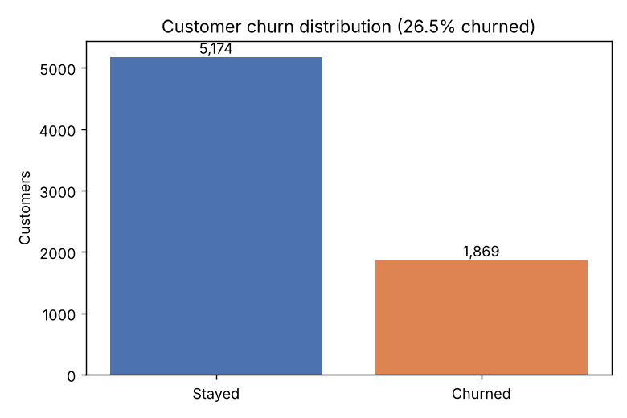
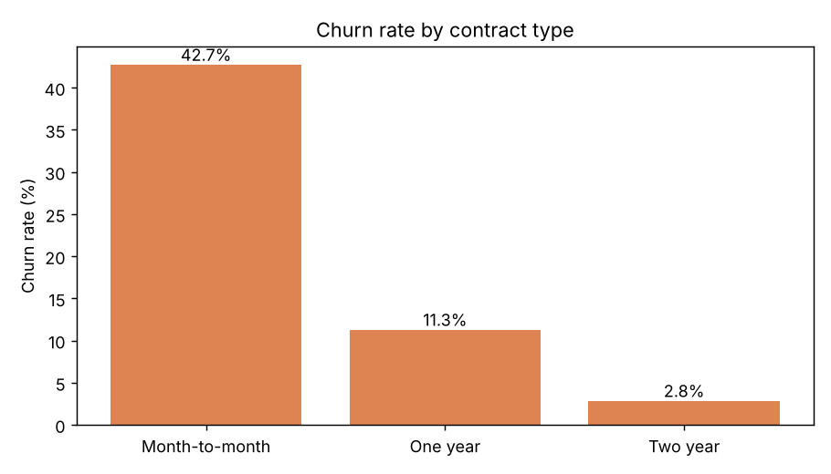
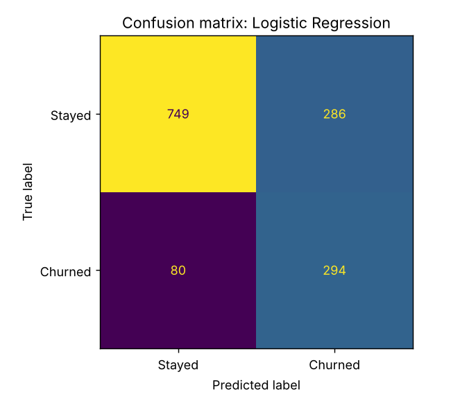
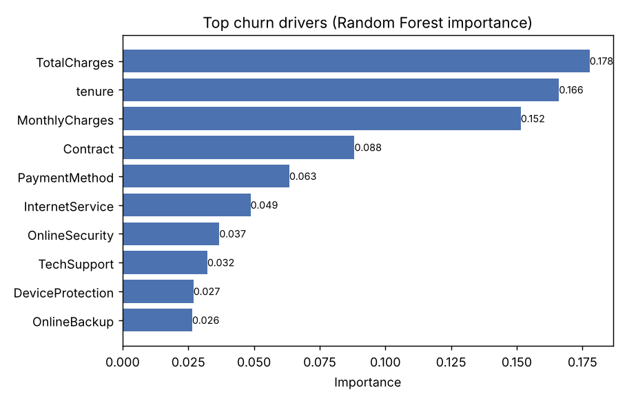
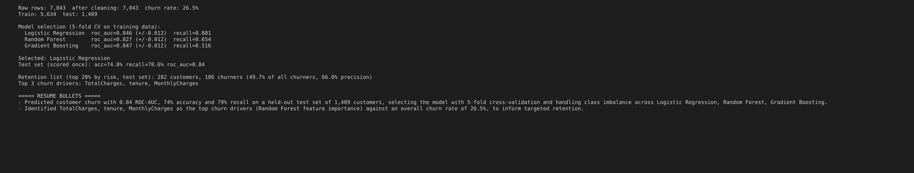

# Customer Churn Prediction

Predicts which telecom customers are likely to cancel, compares three classifiers, and ranks the features that drive churn. Built on the IBM Telco Customer Churn dataset (7,043 customers).

## Summary

| | |
|---|---|
| Dataset | IBM Telco Customer Churn, 7,043 customers, 20 features |
| Churn rate | 26.5% (1,869 churned) |
| Best model | Logistic Regression: ROC-AUC 0.84, accuracy 74%, recall 79% |
| Top churn drivers | `TotalCharges`, `tenure`, `MonthlyCharges` |
| Strongest signal | Month-to-month contracts churn at 42.7%, versus 11.3% (one year) and 2.8% (two year) |

## Churn overview

<p align="center">
  
  
</p>

Customers on month-to-month contracts leave at roughly four times the rate of one-year contracts and fifteen times the rate of two-year contracts.

## Model comparison

<p align="center">
  
</p>

| Model | Accuracy | Recall | ROC-AUC |
|---|---|---|---|
| **Logistic Regression** (selected) | 0.740 | 0.786 | 0.841 |
| Random Forest | 0.775 | 0.652 | 0.828 |
| Gradient Boosting | 0.798 | 0.508 | 0.842 |

Logistic Regression and Gradient Boosting have nearly identical ROC-AUC. The selection rule breaks that tie in favour of recall, because a missed churner costs more than a false alarm. Gradient Boosting has the highest accuracy but catches only half of the churners.

## Best model results

<p align="center">
  
  
</p>

## Console output

<p align="center">
  
</p>

Full text is in [`docs/results.txt`](docs/results.txt).

## What it does

1. **Cleaning.** Removes duplicate `customerID` rows. Blank `TotalCharges` values (11 rows, all tenure-0 customers) are set to 0. Any other gaps are filled with the median.
2. **Features.** One-hot encodes categorical columns. `customerID` is dropped, and `Churn` is removed from the features.
3. **Models.** Logistic Regression (scaled, class-balanced), Random Forest (class-balanced), and Gradient Boosting, all on an 80/20 stratified split with a fixed seed.
4. **Model selection.** Best by ROC-AUC. Models within 0.005 AUC of the top are treated as tied, and recall breaks the tie.
5. **Drivers.** Sums Random Forest feature importances back to the original columns, so `Contract_One year` and `Contract_Two year` count as one driver: `Contract`.

## Setup

```bash
python -m venv .venv
source .venv/bin/activate        # Windows: .venv\Scripts\activate
pip install -r requirements.txt
```

## Run

```bash
python churn_prediction.py --data data/WA_Fn-UseC_-Telco-Customer-Churn.csv --outdir docs
```

This prints the report, writes `docs/results.txt`, and regenerates everything in `docs/images/`.

## Tests

```bash
pip install -r requirements-dev.txt
pytest
```

Tests use a generated synthetic dataset, so they run without the data file. CI runs them on every push via GitHub Actions.

## Project layout

```
churn_prediction.py    # cleaning, modelling, evaluation, CLI
plots.py               # figure and console-image generation
data/                  # IBM Telco churn CSV
docs/                  # results.txt and images/ used in this README
tests/                 # pytest suite
```

## Data source and licence

The Telco Customer Churn dataset is IBM sample data, distributed through the [IBM/telco-customer-churn-on-icp4d](https://github.com/IBM/telco-customer-churn-on-icp4d) repository. Check that repository's licence before redistributing it commercially.

## Notes

- The median fill for `TotalCharges` is computed on the full dataset before splitting. This is a small amount of leakage, acceptable for this exploratory scope.
- Recall is reported at the default 0.5 probability threshold. Lowering the threshold would catch more churners at the cost of more false alarms.
